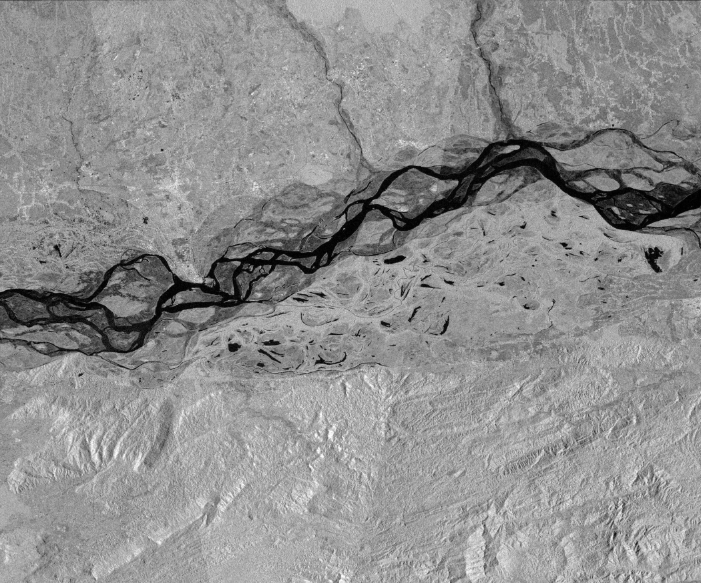
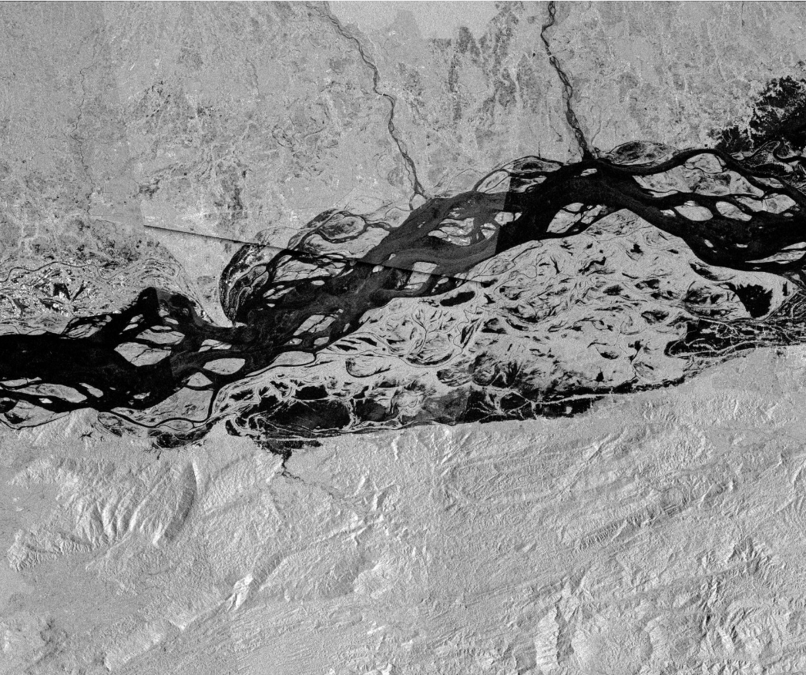

<div align="center">

# 🌊 Flood Detection System

**Mapping flood-affected areas from Sentinel-1 SAR satellite imagery**

[](https://flood-detection-system-m2iq.onrender.com/)

### Tech Stack


</div>

---

## Overview

A web application that detects flooded areas by comparing Sentinel-1 radar
images taken before and after a flood. Radar sees through clouds, so floods
can be mapped even during heavy monsoon rain.

| Pre-flood | Post-flood |
|:---:|:---:|
|  |  |

## Features

- **Regional analysis** of six flood-prone regions in India
- **Custom detection** from your own pre-flood and post-flood images
- **Interactive map** with the flood extent highlighted in red
- **Impact statistics** showing the percentage of area inundated

## How It Works

1. Sentinel-1 images are downloaded from Google Earth Engine.
2. Pre-flood and post-flood images are converted to grayscale and smoothed.
3. Pixels with a significant change in radar backscatter are marked as flooded.
4. Noise is removed and the flood mask is shown on the map with statistics.

## Run Locally

```bash
git clone https://github.com/Vijaypn87/Flood-Detection-System.git
cd Flood-Detection-System
pip install -r requirements.txt
python app/app.py
```

Open **http://localhost:5000** in your browser.
